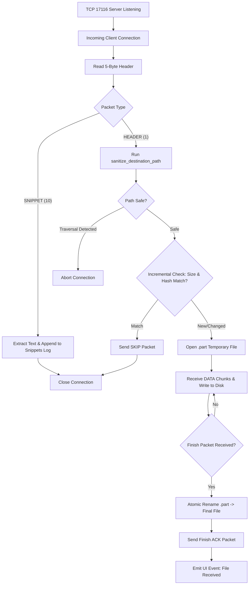

# RDR-Transit: UI/UX Specification & Interface Engineering Guide

> **Target Audience:** Frontend Engineers, UI/UX Designers, Autonomous Agents  
> **Scope:** Terminal User Interface (Textual TUI).  
> **Status:** Canonical Living Interface Reference

---

## 1. Design System & Visual Philosophy

RDR-Transit provides a focused, high-performance user interface:
- **Terminal User Interface (TUI)**: Keyboard-centric, `nmtui`-inspired, full-screen console client for SSH sessions, headless servers, and terminal power users.

### 1.1 Unified Color Palette & Semantics

The terminal interface adheres to a cohesive **Cyber-Dark** design language featuring high-contrast accents against deep blue-black backgrounds:

| Semantic Role | Hex Code | Visual Swatch | Purpose / Usage |
| :--- | :--- | :--- | :--- |
| **Canvas Background** | `#11141C` / `#0D1117` | Dark Void | Main backdrop, minimizing eye strain during large transfers |
| **Surface / Card** | `#181C27` / `#161B22` | Slate Panel | Container panels, list cards, modals, and tab frames |
| **Accent Primary** | `#00E5FF` / `#89DCEB` | Electric Cyan | Primary actions, headings, active selections, transfer focus |
| **Accent Success** | `#00E676` / `#A6E3A1` | Neon Mint | Online beacons, completed transfers, active daemon status |
| **Accent Warning** | `#F9E2AF` / `#FFB74D` | Amber Glow | Incremental skips, away status, temporary network retries |
| **Accent Danger** | `#FF5252` / `#F38BA8` | Vivid Coral | Transfer errors, cancel buttons, stopped daemons |
| **Subdued Text** | `#B0BEC5` / `#6C7086` | Dim Slate | Secondary paths, byte counts, timestamps, ports |

---

## 2. Interactive Terminal UI (TUI)

Implemented in [`src/rdr_transit/tui/app.py`](file:///home/victor/antigravity/RDR-transit/src/rdr_transit/tui/app.py), [`screens.py`](file:///home/victor/antigravity/RDR-transit/src/rdr_transit/tui/screens.py), and [`styles.tcss`](file:///home/victor/antigravity/RDR-transit/src/rdr_transit/tui/styles.tcss).

### 2.1 Screen Architecture & Layout Blueprint

```
+----------------------------------------------------------------------------------------------------+
| ⚡ RDR TRANSIT | workstation-alpha (Linux)                                       IP: 192.168.1.100 |
+-------------------------------------------------+--------------------------------------------------+
| 📡 Discovered Network Peers                     | 📦 Staged Items to Send                          |
| +---------------------------------------------+ | +----------------------------------------------+ |
| | Status   | Device Name  | OS    | IP        | | | 📄 /home/victor/docs/report.pdf (14.2 MB)    | |
| |----------+--------------+-------+-----------| | | 📁 /home/victor/projects/src/ (48 files)     | |
| | ● ONLINE | laptop-win   | Win   | 192.168...| | |                                              | |
| | ● ONLINE | macbook-air  | macOS | 192.168...| | |                                              | |
| | ○ IDLE   | phone-galaxy | Andr  | 192.168...| | | Total: 49 files (128.5 MB)                  | |
| +---------------------------------------------+ | +----------------------------------------------+ |
| [ Scan Peers (d) ]       [ Direct IP ]          | [ Add Path (a) ] [ Snippet (p) ] [ Clear ] [Send]|
|                                                 +--------------------------------------------------+
|                                                 | 📥 Incoming Receiver Daemon                      |
|                                                 | Status: ● Listening on TCP 17116 (Auto-accept)   |
|                                                 | [ Toggle Receiver (r) ]                          |
+-------------------------------------------------+--------------------------------------------------+
| q Quit | d Scan | a Add | p Snippet | c Clear | s Send | r Receiver | ? Help                       |
+----------------------------------------------------------------------------------------------------+
```

### 2.2 Global Keyboard Navigation Matrix

The TUI provides complete keyboard controllability designed for speed:

| Key Binding | Action Method | Description |
| :--- | :--- | :--- |
| `q` | `action_quit()` | Immediately aborts active transfers and exits cleanly. |
| `d` | `action_scan_peers()` | Triggers UDP broadcast beacon and refreshes the peer table. |
| `a` | `action_add_path()` | Opens the **Add Path Modal** to enter a file or folder path. |
| `p` | `action_send_snippet()`| Opens the **Send Snippet Modal** for instant text/clipboard transfer. |
| `s` | `action_send_staged()` | Initiates streaming all staged files to the selected peer. |
| `c` | `action_clear_queue()` | Empties the staged files queue. |
| `r` | `action_toggle_receiver()`| Toggles the local TCP `17116` receiver server on/off. |
| `?` | `action_show_help()` | Opens the interactive shortcut cheatsheet modal. |
| `Tab` / `Shift+Tab` | Built-in Focus Cycle | Moves cursor between Peer Table, Staging List, and Action Buttons. |
| `↑` / `↓` / `Enter` | DataTable Selection | Highlights and selects destination peer in the peer table. |

### 2.3 Modal Dialog System

The TUI utilizes reactive `ModalScreen` overlays with darkened backdrops:

1. **`AddPathDialog`**:
   - Dedicated path input with auto-expansion of `~` and relative paths.
   - Validates existence on disk before accepting; displays an error toast if path does not exist.
2. **`ManualPeerDialog`**:
   - Allows typing a raw IP address (e.g. `192.168.1.150`) for transferring across subnets where UDP broadcast is restricted.
3. **`SendSnippetDialog`**:
   - Single-line or multiline input for URLs, tokens, or clipboard snippets.
4. **`TransferProgressModal`**:
   - Displayed during active file transmission.
   - Features dynamic progress bar (`ProgressBar`), current file description, speed counter (`Speed: X.XX MB/s`), byte totals, and a **Cancel** button.
   - On completion, transforms into a completion summary with a **Close** button.

---

## 3. End-to-End User Interaction Flowcharts

### 3.1 File Staging, Peer Discovery & Transfer Flow

```mermaid
flowchart TD
    Start([User Opens RDR-Transit TUI]) --> Disc[UDP 56780 Background Discovery]
    Disc --> PeerFound{Peer Detected?}
    PeerFound -- Yes --> ShowPeer[Display in Peer Table]
    PeerFound -- No --> DirectIP[Enter Direct IP Address]
    
    ShowPeer --> StageFiles[Stage Files / Folders via Modal (a)]
    DirectIP --> StageFiles
    
    StageFiles --> ClickSend[Trigger Send Action (s)]
    ClickSend --> ConnCheck{Connect TCP 17116}
    
    ConnCheck -- Failed --> ErrToast[Display Error Toast / Notification]
    ConnCheck -- Success --> SendHdr[Send 5-byte Header + JSON Preamble]
    
    SendHdr --> RecvReply{Receiver Response}
    RecvReply -- SKIP --> SkipFile[Mark File Skipped: Identical Content]
    RecvReply -- OK --> StreamChunks[Stream 96 KB Data Packets]
    
    StreamChunks --> Meter[Update Dual Progress Meters]
    Meter --> MoreBytes{More Bytes?}
    MoreBytes -- Yes --> StreamChunks
    MoreBytes -- No --> SendFinish[Send Finish Packet]
    
    SendFinish --> AwaitAck[Await Finish ACK]
    AwaitAck --> BatchDone{More Files in Batch?}
    BatchDone -- Yes --> SendHdr
    BatchDone -- No --> Summary[Display Transfer Summary]
```

### 3.2 Receiver Daemon Handshake & Storage Flow



---

## 4. UI Performance & Accessibility Invariants

To guarantee a responsive user experience in the terminal interface:

1. **Non-Blocking Invariant**:
   - Sockets and heavy filesystem operations must NEVER execute on the Textual main thread.
   - Use asynchronous Textual workers (`@work(exclusive=True)`) or daemon threads for transfers.
2. **Terminal Graceful Resizing**:
   - The TUI layout uses flexible fractions (`1fr`) and percentages (`50%`) so resizing the terminal window never crashes Textual or clips buttons.
3. **Instant Visual Feedback**:
   - Every network action (scanning, sending, canceling) produces immediate visual feedback within $< 50\text{ms}$ (status beacon change, progress bar update, or notification toast).
