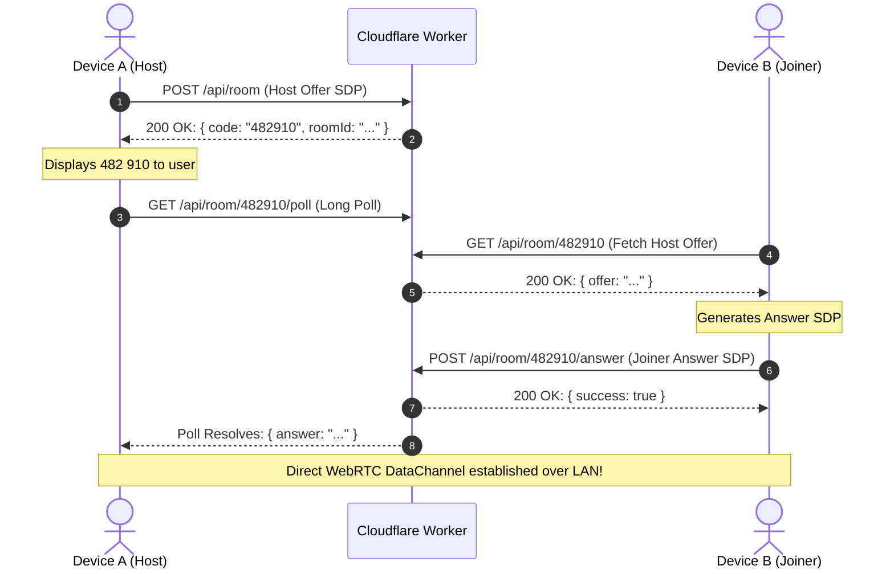

# RDR-Transit Cloudflare Worker Signaling Service

A high-performance, serverless signaling matchmaker for **RDR-Transit Web P2P**.

It coordinates initial 6-digit PIN WebRTC handshakes (`< 3 KB` compressed SDP tokens) between two browser tabs or devices without requiring third-party broker accounts or complex setup.

> [!NOTE]
> **Zero File Data on Cloudflare**:
> The Worker **never** touches or relays file data, folders, or binary streams. All file transfers are streamed **100% direct machine-to-machine via WebRTC DataChannels over local Wi-Fi**. The Worker only acts as an ephemeral matchmaker for the initial 2-minute handshake.

---

## Architecture & REST Endpoints



### Endpoints
- `GET /api/health`: Uptime, active rooms, and server status.
- `POST /api/room`: Registers a host offer and returns an ephemeral 6-digit numeric PIN (TTL: 120s).
- `GET /api/room/:code`: Joiner retrieves the host's offer token.
- `POST /api/room/:code/answer`: Joiner submits the WebRTC answer token.
- `GET /api/room/:code/poll`: Host waits/polls for the answer (supports long-polling with configurable timeout).
- `POST /api/reconnect`: Coordinates seamless re-pairing on page refresh.

---

## Quickstart & Local Development

### Prerequisites
- Node.js v18+
- `pnpm` or `npm`

### 1. Install Dependencies
```bash
cd worker
pnpm install
```

### 2. Run Local Development Server
```bash
pnpm run dev
# Starts local worker on http://localhost:8787
```

### 3. Deploy to Cloudflare
Deploy to your Cloudflare account with a single command:
```bash
npx wrangler deploy
```

Once deployed, copy the assigned Worker URL (e.g. `https://rdr-transit-signaling.<your-subdomain>.workers.dev`) and set it in the RDR-Transit Web App settings.
